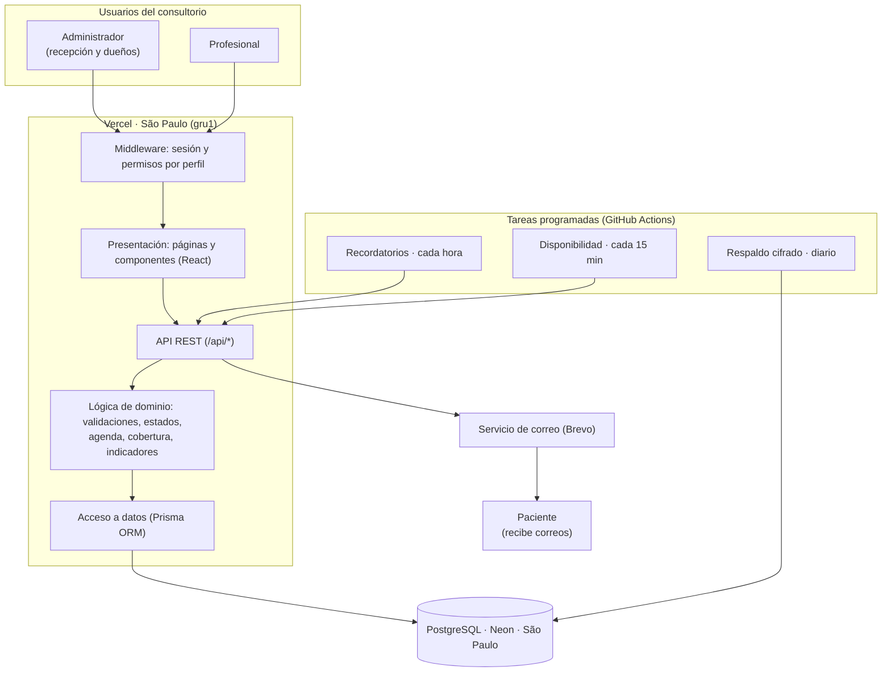

# Arquitectura lógica

KineTurnos es una aplicación web de una sola base de código (Next.js), publicada en la nube. El personal del consultorio la usa desde el navegador, en computadora o celular, sin instalar nada (RNF02, RNF10).

## Diagrama

## Capas

| Capa | Qué hace | Dónde está |
|---|---|---|
| **Presentación** | Pantallas (panel, agenda, pacientes, historia clínica, obras sociales, profesionales, usuarios) adaptadas a computadora y celular | `src/app/*/page.tsx`, `src/components/` |
| **Estado del cliente** | Carga y actualización de datos de cada pantalla | `src/hooks/use-*.ts`, `src/lib/api/*-client.ts` |
| **Seguridad** | Inicio de sesión con contraseña cifrada (bcrypt). El middleware protege cada página según el perfil, y la API revalida el usuario y sus permisos en cada pedido | `src/middleware.ts`, `src/auth.ts`, `src/lib/auth/` |
| **API REST** | Recibe los pedidos, valida el formato y traduce los errores a respuestas HTTP | `src/app/api/**/route.ts`, `src/lib/api/` |
| **Lógica de dominio** | Reglas del negocio, compartidas por el formulario y el servidor: disponibilidad y solapamientos, estados del turno, cobertura de obras sociales, historia clínica, indicadores | `src/lib/*.ts` |
| **Acceso a datos** | Consultas y transacciones con la base; bloqueos para que dos personas no agenden el mismo horario; registro de accesos a la historia clínica | `src/lib/db/`, `prisma/schema.prisma` |
| **Base de datos** | PostgreSQL administrado, con migraciones versionadas | Neon, región `sa-east-1` |

## Servicios externos y tareas programadas

- **Correo (RF05).** Cada cambio de un turno encola el correo en la base dentro de la misma operación. Después de responder, la app lo envía por Brevo. Si el envío falla, se reintenta.
- **Recordatorios (RF05).** Cada hora, GitHub Actions llama a un endpoint protegido con una clave. Ese endpoint encola los recordatorios de los turnos de las próximas 24 horas.
- **Disponibilidad (RNF08).** Cada 15 minutos se verifica que la app y la base respondan. Si fallan, llega un aviso por correo ([DISPONIBILIDAD.md](DISPONIBILIDAD.md)).
- **Respaldos (RNF09).** Todos los días se hace una copia completa de la base, cifrada, que se conserva 14 días ([RESPALDOS.md](RESPALDOS.md)).
- **Integración continua.** Cada cambio pasa por lint, compilación, pruebas unitarias, de integración contra una base real, de punta a punta en el navegador, y la prueba de respaldo y restauración, antes de publicarse ([TESTING.md](TESTING.md)).

## Decisiones de arquitectura

| Decisión | Motivo |
|---|---|
| Aplicación web, sin app nativa | Funciona en la computadora de recepción y en el celular del profesional sin instalar nada (RNF02, RNF10). La app nativa queda fuera del alcance |
| Next.js: interfaz y API en un mismo proyecto | Un solo lenguaje (TypeScript) y un solo despliegue. Las reglas del negocio se escriben una vez y las usan el formulario y el servidor |
| Servicios en la nube (Vercel y Neon) | Disponibles las 24 h sin un servidor en el consultorio (RNF08); sin costo para el volumen del consultorio |
| App y base en la misma región (São Paulo) | Cada consulta a la base tarda 1 a 2 ms en lugar de cruzar el continente. Bajó un 44 % el tiempo de respuesta medido ([RENDIMIENTO.md](RENDIMIENTO.md)) |
| Permisos centralizados (matriz perfil × permiso) | Sumar un perfil o un módulo nuevo es agregar filas a la matriz, sin rediseñar el sistema (RNF11) |
| Capas separadas (presentación, API, dominio, datos) | Cada regla está en un solo lugar y tiene pruebas propias (RNF12) |
| Notificaciones encoladas en la base | Un turno nunca queda guardado sin su correo ni al revés. Si el servicio de correo falla, el turno se guarda igual y el correo se reintenta |
