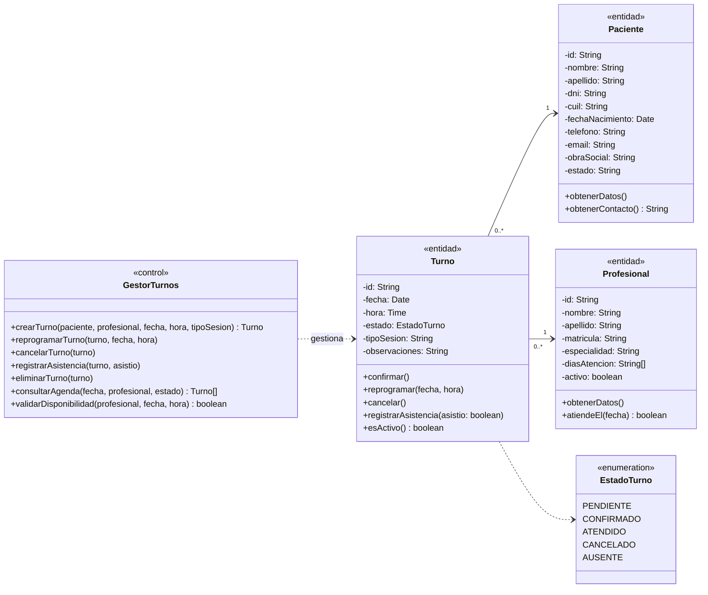

# Diagrama de clases — Gestión de Turnos y Agenda

Clases del paquete de negocio Gestión de Turnos y Agenda, tal como quedaron implementadas. Los turnos duran siempre 1 hora y el horario del consultorio (08:00 a 18:00) es común a todos los profesionales: cada profesional solo define sus días de atención.

Un Turno pertenece a un único Paciente y un único Profesional; un Paciente o Profesional puede tener múltiples Turnos asociados.
