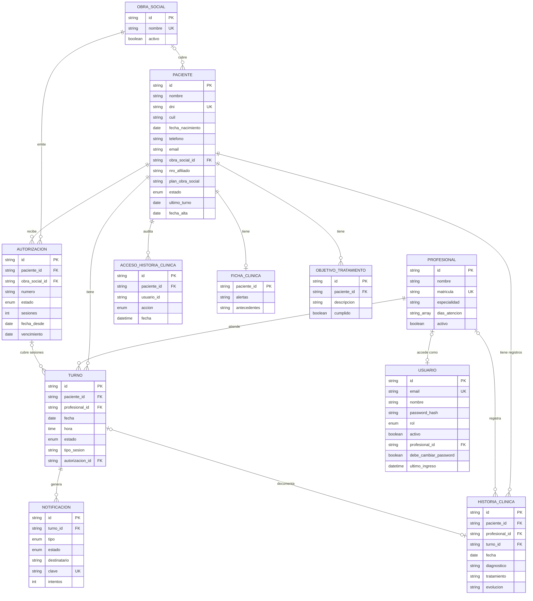

# Modelo entidad-relación (DER)

Modelo de datos de KineTurnos tal como quedó implementado en PostgreSQL ([`prisma/schema.prisma`](../prisma/schema.prisma)). Los nombres son los de las tablas; entre paréntesis, la entidad del modelo.

## Diagrama

## Entidades

### Núcleo operativo (Fase 1)

**Paciente** (`pacientes`): datos personales y de contacto (RF06, RF08).
- DNI obligatorio y único (normalizado sin puntos).
- CUIL y fecha de nacimiento opcionales: la edad se calcula.
- Obra social del catálogo con número de afiliado y plan, o "Particular". El nombre de la obra social se guarda también desnormalizado, para listar y buscar.
- `ultimo_turno` = último turno atendido con fecha hasta hoy.
- Estado activo o inactivo: un paciente con historia clínica no se borra, se desactiva.

**Profesional** (`profesionales`): kinesiólogo con matrícula única, especialidad, días de atención (lunes a sábado) y estado activo (RF09). El horario del consultorio (08:00 a 18:00) es común a todos.

**Usuario** (`usuarios`): acceso al sistema (RF18, RF19).
- **Perfil:** `admin` (Administrador: dueños y recepción), `profesional` o `superadmin` (nivel técnico, RNF13).
- **Contraseña:** se guarda cifrada con bcrypt (RNF05). `debe_cambiar_password` obliga a elegir una propia después de una contraseña temporal.
- **Perfil Profesional:** se vincula a un único Profesional, del que ve la agenda.
- **Baja:** no se borra, se desactiva.
- **`ultimo_ingreso`:** registra el último inicio de sesión.

**Turno** (`turnos`): sesión de 1 hora entre un paciente y un profesional (RF01 a RF04).
- **Estados:** activos (`pendiente`, `confirmado`) y finales (`atendido`, `cancelado`, `ausente`).
- **Nombres desnormalizados:** guarda el nombre del paciente y del profesional, para el historial.
- **Integridad:** un índice único parcial impide dos turnos activos del mismo profesional en el mismo horario.

### Historia clínica (Fase 2)

**HistoriaClinica** (`historia_clinica`): un registro por sesión (RF11 a RF13).
- Evolución obligatoria; diagnóstico y plan de tratamiento opcionales.
- Puede vincularse al turno que documenta: uno por turno.
- Guarda el autor, porque solo él puede corregirlo, y dentro de las 24 h.

**AccesoHistoriaClinica** (`accesos_historia_clinica`): trazabilidad (RNF07). Cada lectura, alta o edición de la información clínica guarda quién (usuario, nombre y perfil), qué acción y cuándo.

**FichaClinica** (`fichas_clinicas`): una por paciente, con alertas clínicas (alergias, contraindicaciones) y antecedentes.

**ObjetivoTratamiento** (`objetivos_tratamiento`): objetivos del tratamiento del paciente, con su estado de cumplimiento.

### Obras sociales (Fase 3)

**ObraSocial** (`obras_sociales`): catálogo de obras sociales y prepagas, con nombre único sin distinguir mayúsculas ni espacios repetidos (RF07).

**Autorizacion** (`autorizaciones`): autorización de la obra social para un tratamiento (RF14, RF15).
- Cantidad de sesiones, fecha desde y vencimiento opcional.
- Estado: pendiente, aprobada o rechazada.
- Cada turno que pasa a atendido se vincula a la autorización aprobada vigente que vence primero (`turnos.autorizacion_id`). Así se cuentan las sesiones usadas y se arma la planilla mensual para facturar.

### Notificaciones (Fase 4)

**Notificacion** (`notificaciones`): correo al paciente por un turno (RF05).
- **Tipos:** creación, confirmación, reprogramación, cancelación o recordatorio 24 h antes.
- **Cuándo se crea:** en la misma transacción que la escritura del turno. Guarda los datos del turno al momento del evento.
- **Estados:** pendiente, enviando, enviada, fallida u omitida, con intentos para reintentar.
- **`clave` única:** evita correos duplicados.

### Técnica

**LoginIntento** (`login_intentos`): intentos fallidos de inicio de sesión por email e IP, para bloquear temporalmente después de 5 errores. No se relaciona con otras entidades.

## Relaciones y cardinalidades

| Relación | Cardinalidad | Al borrar |
|---|---|---|
| Paciente — Turno | 1 a muchos | Se borran sus turnos (solo si no tiene turnos activos) |
| Profesional — Turno | 1 a muchos | Ídem |
| Profesional — Usuario | 0..1 a 0..1 (perfil Profesional) | El usuario queda sin vínculo |
| ObraSocial — Paciente | 0..1 a muchos | No se puede borrar una obra social con pacientes |
| Paciente — Autorizacion | 1 a muchos | Se borran |
| ObraSocial — Autorizacion | 1 a muchos | No se puede borrar una obra social con autorizaciones |
| Autorizacion — Turno | 0..1 a muchos (sesiones atendidas) | Los turnos quedan sin autorización |
| Turno — Notificacion | 1 a muchos | Se borran |
| Paciente — HistoriaClinica | 1 a muchos | **No se puede borrar** un paciente con historia clínica |
| Profesional — HistoriaClinica | 0..1 a muchos | El registro conserva el nombre del profesional |
| Turno — HistoriaClinica | 0..1 a 0..1 | El registro queda sin turno |
| Paciente — AccesoHistoriaClinica | 1 a muchos | Se borran |
| Paciente — FichaClinica | 1 a 0..1 | Se borra |
| Paciente — ObjetivoTratamiento | 1 a muchos | Se borran |

## Cambios respecto del diseño inicial

Durante el desarrollo, el modelo creció con cada fase:

- **Entidades nuevas:** HistoriaClinica, AccesoHistoriaClinica, FichaClinica, ObjetivoTratamiento, ObraSocial, Autorizacion y Notificacion (más LoginIntento, técnica).
- **Paciente:** CUIL, fecha de nacimiento, obra social del catálogo (`obra_social_id`), número de afiliado y plan.
- **Usuario:** perfil Superadmin, vínculo con su Profesional, contraseña temporal (`debe_cambiar_password`), último ingreso y fecha de alta.
- **Turno:** vínculo con la Autorizacion que cubre la sesión.
